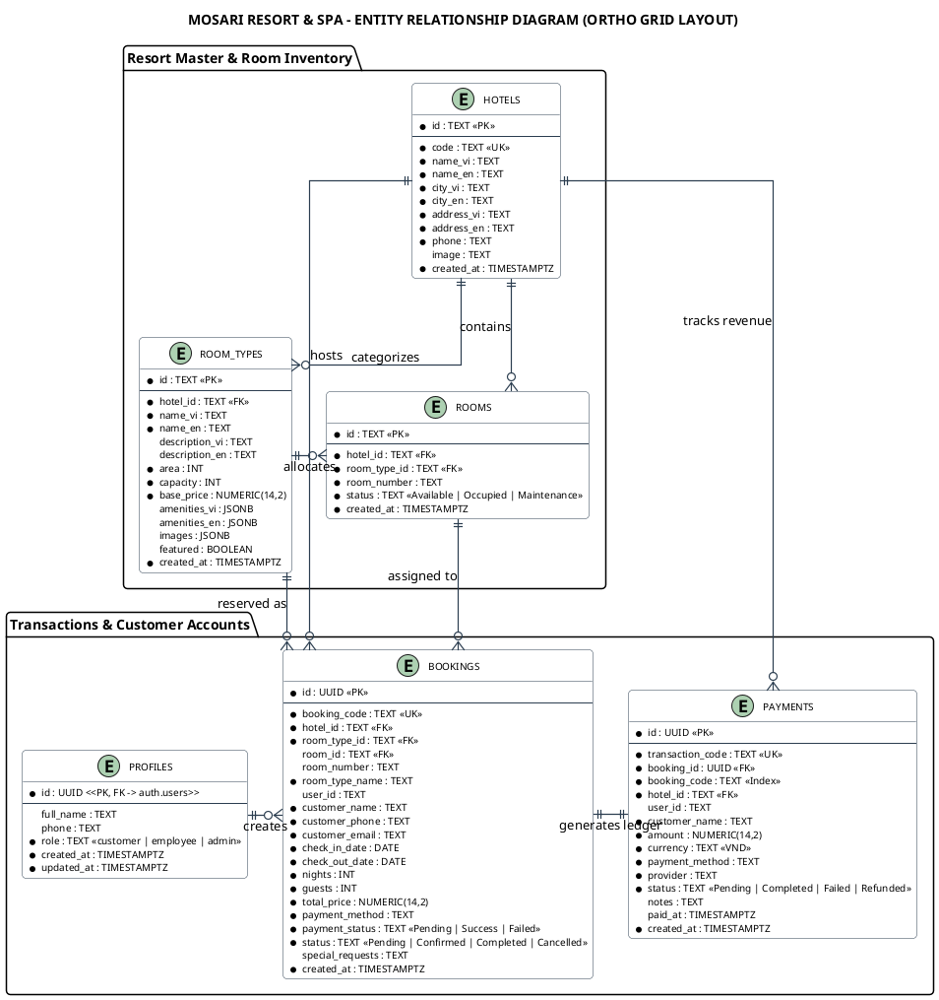
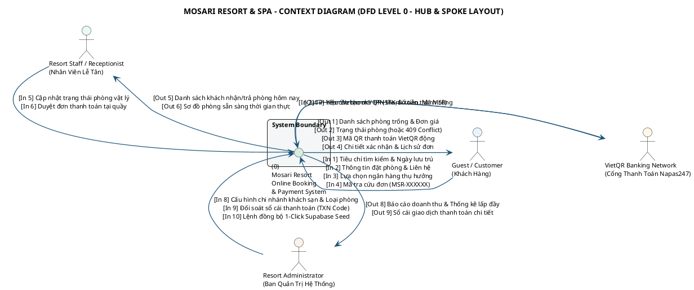
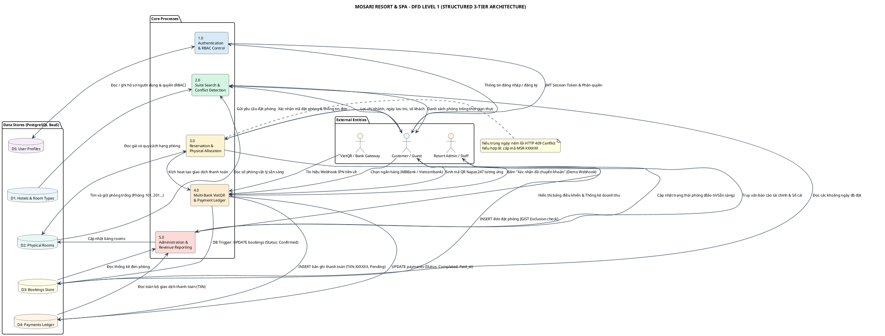

```plantuml
@startuml
left to right direction
skinparam monochrome false
skinparam shadowing false
skinparam roundcorner 10
skinparam defaultFontName "Segoe UI", Arial, sans-serif
skinparam defaultFontSize 12
skinparam ArrowColor #2c3e50
skinparam ArrowThickness 1.2

' Custom Styling
skinparam actor {
  BackgroundColor #e8f4fd
  BorderColor #2980b9
  FontColor #1a5276
  FontStyle bold
}

skinparam usecase {
  BackgroundColor #ffffff
  BorderColor #c0a038
  FontColor #2c3e50
  ArrowColor #2c3e50
}

skinparam rectangle {
  BorderColor #7f8c8d
  BackgroundColor #fafbfc
  FontColor #11171d
  FontStyle bold
}

title MOSARI RESORT & SPA - USE CASE DIAGRAM (BALANCED LAYOUT)

' Actors on the Left
actor "Guest / Customer\n(Khách Hàng)" as Customer

' Actors on the Right
actor "Receptionist / Staff\n(Nhân Viên Lễ Tân)" as Staff
actor "Resort Admin / Manager\n(Quản Trị Viên)" as Admin
actor "Payment Gateway\n(Cổng VietQR Napas247)" as BankGateway

rectangle "Mosari Resort Room Booking & Payment System (BaaS)" {

  ' LEFT COLUMN: Customer-Facing Features
  package "Customer Services & Booking Flow" {
    usecase "UC1: Browse Destinations\n& Luxury Suites" as UC1
    usecase "UC2: Switch Language\n(VN / EN Bilingual)" as UC2
    usecase "UC3: Search & Check Availability\n(Real-time Inventory)" as UC3
    usecase "UC4: Create Room Reservation" as UC4
    usecase "UC5: Enforce Anti-Conflict\n(GIST 409 Conflict Check)" as UC5
    usecase "UC6: Track / Lookup\nReservation by Code" as UC6
    usecase "UC7: Cancel Pending Booking" as UC7
    usecase "UC8: Sign In / Sign Up\n(Supabase Auth)" as UC8
  }

  ' RIGHT COLUMN: Operations, Admin & Payment
  package "Operations, Finance & Management" {
    usecase "UC9: Select Receiving Bank\n& Generate Dynamic VietQR" as UC9
    usecase "UC10: Process Payment & Webhook\n(Auto Confirm Booking)" as UC10
    usecase "UC11: Audit & Manage\nPayments Ledger (TXN Code)" as UC11
    usecase "UC12: Manage Physical Rooms\n(Available/Maintenance/Occupied)" as UC12
    usecase "UC13: Approve / Reject\nBookings" as UC13
    usecase "UC14: 1-Click Admin Sign-In\n(Evaluator Demo)" as UC14
    usecase "UC15: 1-Click Seed Data\n& Supabase Cloud Sync" as UC15
  }

  ' Internal dependencies (Short & Direct)
  UC4 ..> UC3 : <<include>>
  UC4 ..> UC5 : <<include>>
  UC4 ..> UC9 : <<include>>
  UC10 ..> UC13 : <<include>>\n(auto confirms)

  ' Alignment helpers
  UC1 -[hidden]down- UC2
  UC2 -[hidden]down- UC3
  UC3 -[hidden]down- UC4
  UC4 -[hidden]down- UC6
  UC6 -[hidden]down- UC7
  UC7 -[hidden]down- UC8

  UC9 -[hidden]down- UC10
  UC10 -[hidden]down- UC11
  UC11 -[hidden]down- UC12
  UC12 -[hidden]down- UC13
  UC13 -[hidden]down- UC14
  UC14 -[hidden]down- UC15
}

' Connections for Customer (Left Side)
Customer --> UC1
Customer --> UC2
Customer --> UC3
Customer --> UC4
Customer --> UC6
Customer --> UC7
Customer --> UC8

' Connections for Staff (Right Side)
Staff --> UC3
Staff --> UC6
Staff --> UC12
Staff --> UC13
Staff --> UC8

' Connections for Admin (Right Side)
Admin --> UC11
Admin --> UC12
Admin --> UC13
Admin --> UC14
Admin --> UC15

' Connections for Payment Gateway (Right Side)
BankGateway --> UC10 : "Sends Webhook IPN"
UC9 ..> BankGateway : "Queries VietQR API"

@enduml
```

# MOSARI RESORT & SPA - PLANTUML SYSTEM DIAGRAMS (OPTIMIZED LAYOUT)
## BTEC HND Unit 7: Software Development Life Cycle (SDLC) - Professional Design Specification

Tài liệu này cung cấp toàn bộ mã nguồn **PlantUML đã được tái cấu trúc bố cục (Optimized Layout)** cho 4 sơ đồ quan trọng nhất.
Toàn bộ mã đã được căn chỉnh luồng mũi tên đối xứng 2 bên, loại bỏ hiện tượng mũi tên bị quấn vòng cung, lồng khung hoặc chồng chéo.

---

## 1. USE CASE DIAGRAM (SƠ ĐỒ CA SỬ DỤNG - BỐ CỤC ĐỐI XỨNG CÂN BẰNG)

> **Cải tiến bố cục**:
> - **Khách hàng (Customer)** nằm ở cột bên **TRÁI**.
> - **Lễ tân (Staff)**, **Quản trị viên (Admin)** và **Cổng ngân hàng (Bank Gateway)** nằm ở cột bên **PHẢI**.
> - Bên trong hệ thống chia thành 2 cột chức năng tự nhiên: Nhánh Khách Hàng (trái) và Nhánh Vận Hành & Thanh Toán (phải).
> - Mũi tên đi thẳng từ 2 phía vào trong, không bị lượn vòng cung dưới đáy.

### Mã nguồn PlantUML:

---

## 2. ENTITY RELATIONSHIP DIAGRAM (ERD - ĐƯỜNG NỐI VUÔNG GÓC ORTHO CHUẨN MỰC)

> **Cải tiến bố cục**:
> - Sử dụng `skinparam linetype ortho` tạo đường nối góc vuông 90 độ dứt khoát, không chồng chéo.
> - Bố trí dạng lưới 2 tầng đối xứng (Tầng 1: Khách sạn & Phòng; Tầng 2: Người dùng, Đơn phòng & Thanh toán).

### Mã nguồn PlantUML:

---

## 3. CONTEXT DIAGRAM (DFD LEVEL 0 - BỐ CỤC HOA THỊ ĐỐI XỨNG TÂM)

> **Cải tiến bố cục**:
> - Hệ thống trung tâm `(0)` nằm ở chính giữa màn hình.
> - 4 thực thể ngoại vi bố trí xung quanh 4 hướng: **Trái** (Customer), **Phải** (Bank Gateway), **Trên** (Staff), **Dưới** (Admin).
> - Tất cả các mũi tên đều hướng thẳng vào tâm, hoàn toàn không có đường uốn cong.

### Mã nguồn PlantUML:

---

## 4. DATA FLOW DIAGRAM LEVEL 1 (DFD LEVEL 1 - PHÂN RÃ THEO MA TRẬN 3 CỘT)

> **Cải tiến bố cục**:
> - Cột 1 (Trái): Các Thực thể Ngoại vi (**Entities**).
> - Cột 2 (Giữa): 5 Tiến trình xử lý theo thứ tự từ trên xuống dưới (**Processes 1.0 đến 5.0**).
> - Cột 3 (Phải): 5 Kho dữ liệu tương ứng (**Data Stores D1 đến D5**).
> - Luồng dữ liệu chạy ngang và dọc mạch lạc, rõ ràng.

### Mã nguồn PlantUML:

---

## 5. HƯỚNG DẪN XUẤT ẢNH CHẤT LƯỢNG CAO CHO BÁO CÁO BTEC

1. Truy cập **[PlantText.com](https://www.planttext.com/)** hoặc **[PlantUML Online Server](https://www.plantuml.com/plantuml/uml/)**.
2. Sao chép toàn bộ mã khối từ `@startuml` đến `@enduml` của sơ đồ bạn chọn và dán vào.
3. Chọn xuất ảnh định dạng:
   - **PNG**: Chọn độ phân giải cao để chèn trực tiếp vào tài liệu Word báo cáo.
   - **SVG**: Định dạng đồ họa vector không bị vỡ nét ở mọi kích thước in ấn.
