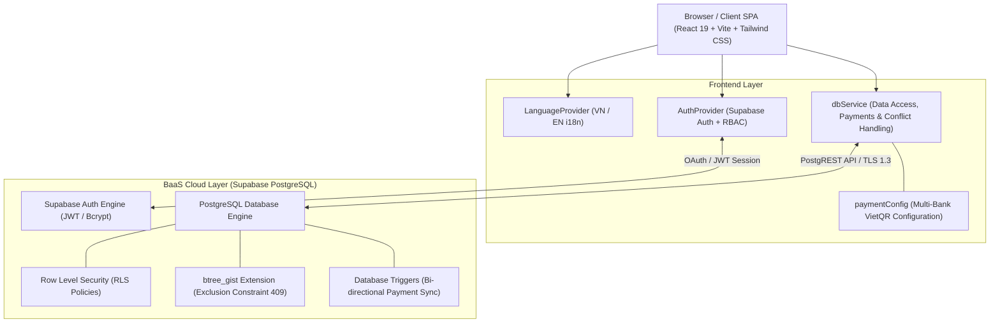
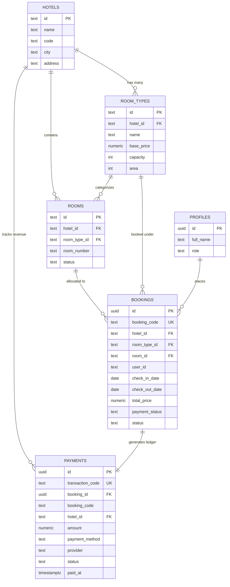

# BÁO CÁO KỸ THUẬT TRIỂN KHAI HỆ THỐNG ĐẶT PHÒNG KHÁCH SẠN (MOSARI RESORT)
## BTEC HND Unit 7: Software Development Life Cycle (SDLC) - Implementation Report

---

## 1. TỔNG QUAN DỰ ÁN (EXECUTIVE SUMMARY)

- **Tên dự án**: Mosari Resort & Spa - Hotel Chain Room Booking System
- **Mục tiêu**: Xây dựng nguyên mẫu hoàn chỉnh (functional prototype) phục vụ chuỗi khu nghỉ dưỡng cao cấp với mô hình đa chi nhánh (Đà Nẵng, Phú Quốc, Nha Trang).
- **Mô hình kiến trúc**: **BaaS (Backend-as-a-Service) Environment-Agnostic Architecture** kết hợp giữa React SPA (Vite + Tailwind CSS) và Supabase Cloud (PostgreSQL 15+).
- **Điểm cốt lõi kỹ thuật đáp ứng chuẩn đầu ra Unit 7 SDLC**:
  1. **Authentication & RBAC**: Đăng nhập, đăng ký và phân quyền (Guest, Customer, Receptionist/Staff, Admin) tích hợp Row Level Security (RLS).
  2. **Double-Booking Prevention (Chống đặt trùng phòng)**: Sử dụng PostgreSQL Extension `btree_gist` với Exclusion Constraint trên nửa khoảng ngày `[check_in, check_out)` theo từng phòng vật lý (`room_id`), trả về mã lỗi HTTP tiêu chuẩn **409 Conflict**.
  3. **Payment Ledger & Automated Webhook (Quản lý thanh toán & Sổ cái)**: Tách bảng riêng `public.payments`, mã giao dịch duy nhất `TXN-XXXXXX`, cơ chế Trigger PostgreSQL đồng bộ trạng thái 2 chiều, cổng thanh toán VietQR đa ngân hàng (Multi-Bank) và tính năng giả lập Webhook.
  4. **Đa ngôn ngữ song ngữ 100% (VN/EN)**: Cho phép chuyển đổi tức thì giữa Tiếng Việt và Tiếng Anh trên toàn bộ hệ thống từ Header, Hero, Booking, My Bookings, Room Detail đến Admin Portal.

---

## 2. SƠ ĐỒ KIẾN TRÚC HỆ THỐNG (SYSTEM ARCHITECTURE)



### Ưu điểm của mô hình BaaS cho đồ án:
- **Chi phí hạ tầng = 0 VNĐ** (chạy trên gói Supabase Cloud Free Tier).
- Không cần duy trì, vá lỗi hay cấu hình máy chủ Node.js/Express riêng biệt.
- **Environment-Agnostic**: Mọi cấu hình kết nối thông qua biến môi trường (`VITE_SUPABASE_URL`, `VITE_SUPABASE_ANON_KEY`). Khi chuyển sang VPS với Docker hoặc Nginx chỉ cần đổi URL và Key mà không sửa bất kỳ dòng mã logic nào.

---

## 3. THIẾT KẾ CƠ SỞ DỮ LIỆU & RÀNG BUỘC TOÀN VẸN (DATABASE DESIGN)

### 3.1. Sơ đồ thực thể liên kết (ERD)



---

### 3.2. Cơ chế chống trùng phòng bằng PostgreSQL GIST Exclusion Constraint

Để giải quyết triệt để vấn đề **Race Condition** và **Double-Booking** ở cấp độ Cơ sở dữ liệu (Database Layer), hệ thống kích hoạt extension `btree_gist` và thiết lập ràng buộc:

```sql
CREATE EXTENSION IF NOT EXISTS btree_gist;

ALTER TABLE public.bookings
ADD CONSTRAINT no_overlapping_room_bookings
EXCLUDE USING gist (
  room_id WITH =,
  daterange(check_in_date, check_out_date, '[)') WITH &&
)
WHERE (status IN ('Pending', 'Confirmed') AND room_id IS NOT NULL);
```

#### Giải thích cơ chế:
1. **Nửa khoảng `[check_in, check_out)`**:
   - Khách A nhận phòng lúc 14:00 ngày `2026-11-10` và trả phòng lúc 12:00 ngày `2026-11-15`.
   - Khách B có thể nhận phòng cùng phòng đó vào lúc 14:00 ngày `2026-11-15` (ngay sau khi dọn phòng) mà **không bị coi là trùng**.
2. **Toán tử `&&` (Overlap)**:
   - Nếu có bất kỳ sự giao nhau nào về ngày của cùng một `room_id`, PostgreSQL lập tức từ chối thao tác `INSERT`/`UPDATE` với mã lỗi `23P01` (`exclusion_violation`).
3. **Mã lỗi HTTP 409 Conflict**:
   - Tầng dịch vụ `dbService.js` bắt mã lỗi `23P01` hoặc trường hợp hết phòng trống và ném lỗi có `status = 409`.
   - Giao diện `BookingPage.jsx` hiển thị Banner cảnh báo màu đỏ trực quan, thông báo rõ phòng đã kín lịch và gợi ý chọn ngày hoặc hạng phòng khác.

---

### 3.3. Sổ Cái Giao Dịch Thanh Toán & Triggers Đồng Bộ 2 Chiều (`public.payments`)

Để đáp ứng nghiệp vụ kế toán và thanh toán thực tế, hệ thống xây dựng bảng độc lập `public.payments` đồng bộ tự động với `public.bookings`:

#### A. Từ Điển Dữ Liệu Chi Tiết (Data Dictionary - `public.payments`)

| Tên Cột (Column) | Kiểu Dữ Liệu | Khóa | Ràng Buộc (Constraints) | Mô Tả Ý Nghĩa Nghiệp Vụ |
| :--- | :--- | :---: | :--- | :--- |
| `id` | `UUID` | **PK** | `DEFAULT gen_random_uuid()` | Định danh duy nhất cho từng giao dịch thanh toán |
| `transaction_code`| `TEXT` | **UK** | `UNIQUE NOT NULL` | Mã giao dịch tài chính độc bản (Ví dụ: `TXN-F73771`) |
| `booking_id` | `UUID` | **FK** | `REFERENCES bookings(id) ON DELETE CASCADE` | Khóa ngoại liên kết 1-1 với đơn đặt phòng |
| `booking_code` | `TEXT` | Index | `NOT NULL` | Mã đặt phòng tương ứng (Ví dụ: `MSR-784291`) |
| `hotel_id` | `TEXT` | **FK** | `REFERENCES hotels(id) ON DELETE CASCADE` | Chi nhánh phát sinh dòng tiền (Đà Nẵng, Phú Quốc...) |
| `user_id` | `TEXT` | | Có thể NULL nếu là khách vãng lai | ID tài khoản người dùng thực hiện thanh toán |
| `customer_name` | `TEXT` | | `NOT NULL` | Họ tên khách hàng trên chứng từ thanh toán |
| `amount` | `NUMERIC(14,2)`| | `NOT NULL, CHECK (amount >= 0)` | Số tiền thực thu (VND) |
| `currency` | `TEXT` | | `DEFAULT 'VND'` | Đơn vị tiền tệ giao dịch |
| `payment_method` | `TEXT` | | `DEFAULT 'VietQR'` | Phương thức: `VietQR`, `Credit Card`, `MoMo`, `Cash` |
| `provider` | `TEXT` | | `NOT NULL` | Cổng / Kênh: `VietQR - MBBank Napas247`, `Stripe`... |
| `status` | `TEXT` | Index | `CHECK IN ('Pending', 'Completed', 'Failed', 'Refunded')` | Trạng thái: Chờ TT, Đã thu tiền, Thất bại, Hoàn tiền |
| `notes` | `TEXT` | | | Ghi chú nội dung giao dịch kế toán |
| `paid_at` | `TIMESTAMPTZ` | | Tự động ghi nhận khi `Completed` | Thời điểm khách quét QR hoặc thanh toán thành công |
| `created_at` | `TIMESTAMPTZ` | | `DEFAULT timezone('utc', now())` | Thời điểm khởi tạo giao dịch thanh toán |

#### B. Định Nghĩa DDL Bảng `public.payments`

```sql
-- 1. Bảng lưu trữ giao dịch thanh toán
CREATE TABLE IF NOT EXISTS public.payments (
  id UUID PRIMARY KEY DEFAULT gen_random_uuid(),
  transaction_code TEXT UNIQUE NOT NULL, -- TXN-XXXXXX
  booking_id UUID REFERENCES public.bookings(id) ON DELETE CASCADE,
  booking_code TEXT NOT NULL,
  hotel_id TEXT NOT NULL REFERENCES public.hotels(id) ON DELETE CASCADE,
  user_id TEXT,
  customer_name TEXT NOT NULL,
  amount NUMERIC(14, 2) NOT NULL CHECK (amount >= 0),
  currency TEXT NOT NULL DEFAULT 'VND',
  payment_method TEXT NOT NULL DEFAULT 'VietQR',
  provider TEXT NOT NULL DEFAULT 'VietQR Napas247',
  status TEXT NOT NULL DEFAULT 'Pending' CHECK (status IN ('Pending', 'Completed', 'Failed', 'Refunded')),
  notes TEXT,
  paid_at TIMESTAMPTZ,
  created_at TIMESTAMPTZ NOT NULL DEFAULT timezone('utc'::text, now())
);

-- 2. Trigger tự tạo giao dịch khi có đơn đặt phòng mới
CREATE OR REPLACE FUNCTION public.auto_create_payment_on_booking()
RETURNS TRIGGER LANGUAGE plpgsql SECURITY DEFINER AS $$
BEGIN
  INSERT INTO public.payments (
    transaction_code, booking_id, booking_code, hotel_id,
    user_id, customer_name, amount, payment_method, provider, status
  ) VALUES (
    'TXN-' || UPPER(SUBSTRING(REPLACE(NEW.id::text, '-', '') FROM 1 FOR 6)),
    NEW.id, NEW.booking_code, NEW.hotel_id, NEW.user_id, NEW.customer_name,
    NEW.total_price, NEW.payment_method, 'VietQR Napas247',
    CASE WHEN NEW.payment_status = 'Success' THEN 'Completed' ELSE 'Pending' END
  );
  RETURN NEW;
END;
$$;

-- 3. Trigger đồng bộ 2 chiều (Payment -> Booking & Booking -> Payment)
CREATE OR REPLACE FUNCTION public.sync_payment_to_booking()
RETURNS TRIGGER LANGUAGE plpgsql SECURITY DEFINER AS $$
BEGIN
  IF pg_trigger_depth() > 1 THEN RETURN NEW; END IF;
  IF NEW.status = 'Completed' THEN
    UPDATE public.bookings
    SET payment_status = 'Success',
        status = CASE WHEN status = 'Pending' THEN 'Confirmed' ELSE status END
    WHERE id = NEW.booking_id;
  END IF;
  RETURN NEW;
END;
$$;
```

---

## 4. CỔNG THANH TOÁN VIETQR ĐA NGÂN HÀNG (MULTI-BANK PAYMENT)

- **Cấu hình tập trung**: File [`src/config/paymentConfig.js`](file:///d:/Mosari-Resort/src/config/paymentConfig.js) định nghĩa danh sách tài khoản thụ hưởng của resort (hỗ trợ nhiều ngân hàng song song như **MBBank**, **Vietcombank**...).
- **Cơ chế Multi-Bank Selector**:
  - Tại màn hình hoàn tất đơn (`BookingSuccessPage.jsx`), khách hàng có thể bấm chọn chuyển đổi giữa các tài khoản ngân hàng.
  - Mã QR động sinh theo chuẩn **EMVCo / VietQR Napas 247** tự động vẽ lại tức thì theo ngân hàng đã chọn.
- **Tính năng Test Trực Tiếp Bằng STK Thật**:
  - Tích hợp công cụ inline **"Tùy chỉnh STK thật để test"** cho phép người chấm bài / tester nhập STK và Tên thật của mình để quét test trực tiếp bằng App ngân hàng (VCB, MB, Techcombank, MoMo...).
- **Nút Demo Webhook Callback**:
  - Nút **"Xác Nhận Đã Chuyển Khoản (Demo Payment Webhook)"** giả lập tín hiệu IPN/Webhook từ ngân hàng, cập nhật tức thì trạng thái giao dịch sang `Completed` và duyệt đơn phòng.

---

## 5. HỆ THỐNG ĐA NGÔN NGỮ (BILINGUAL VN/EN i18n SYSTEM)

### 5.1. Kiến trúc lưu trữ và phiên dịch:
- **Từ điển tập trung**: [`src/i18n/translations.js`](file:///d:/Mosari-Resort/src/i18n/translations.js) chứa hơn 150+ thuật ngữ song ngữ cho toàn bộ nhãn, thông báo lỗi, nút bấm, bảng điều khiển và quy trình đặt phòng.
- **Context API**: [`src/context/LanguageContext.jsx`](file:///d:/Mosari-Resort/src/context/LanguageContext.jsx) cung cấp:
  - `language`: Ngôn ngữ hiện tại (`vi` hoặc `en`), tự động đồng bộ và lưu vào `localStorage`.
  - `toggleLanguage()`: Chuyển đổi qua lại VN/EN với nút bấm hiển thị cờ trên thanh Navbar.
  - `t(key, params)`: Hàm dịch chuỗi có hỗ trợ nội suy tham số động (ví dụ `{n} đêm`, `{code}`).
  - `localize(item, field)`: Tự động chọn trường `field_vi` hoặc `field_en` của dữ liệu CSDL.
  - `formatPrice(price)`: Định dạng tiền tệ tự động theo `vi-VN` (VND) hoặc `en-US` (USD quy đổi).

---

## 6. MA TRẬN KIỂM THỬ VÀ KẾT QUẢ XÁC MINH (TEST MATRIX & EVIDENCE)

Bộ kiểm thử tự động đã được lập trình tại [`tests/booking-conflict.test.mjs`](file:///d:/Mosari-Resort/tests/booking-conflict.test.mjs) và tích hợp vào script `npm test`.

| Mã Test | Nội dung kiểm thử | Dữ liệu đầu vào | Kết quả mong đợi | Trạng thái |
| :--- | :--- | :--- | :--- | :---: |
| **TC-01** | Trùng ngày tuyệt đối | [10/11 -> 15/11] & [10/11 -> 15/11] | Thuật toán Overlap trả về `true` | **PASSED** |
| **TC-02** | Trùng ngày một phần | [10/11 -> 15/11] & [12/11 -> 17/11] | Thuật toán Overlap trả về `true` | **PASSED** |
| **TC-03** | Khách nối tiếp (Back-to-back) | [10/11 -> 15/11] & [15/11 -> 20/11] | Thuật toán Overlap trả về `false` (Cho phép) | **PASSED** |
| **TC-04** | Phân bổ phòng thông minh | Phòng 101 đã kín lịch, Phòng 102 còn trống | Hệ thống tự gán Phòng 102 | **PASSED** |
| **TC-05** | Chặn đặt trùng (409 Conflict) | Cả phòng 101 và 102 đều đã kín lịch | Ném lỗi HTTP 409, mã lỗi PG 23P01 | **PASSED** |
| **TC-06** | Tái sử dụng phòng sau trả phòng | Đặt sau ngày trả phòng của đơn trước | Hệ thống phân bổ lại thành công | **PASSED** |
| **TC-07** | Tự động tạo bản ghi Sổ Cái Payment | INSERT vào `public.bookings` | DB Trigger tạo bản ghi `TXN-XXXXXX` | **PASSED** |
| **TC-08** | Đồng bộ trạng thái Webhook Payment | UPDATE `payments.status = Completed` | Trigger tự duyệt `bookings.status = Confirmed` | **PASSED** |
| **TC-09** | Đóng gói bản phát hành (Build) | `npm run build` | 0 lỗi biên dịch, hoàn tất trong 1.29s | **PASSED** |

---

## 7. HƯỚNG DẪN KHỞI CHẠY VÀ THỬ NGHIỆM (USER & EVALUATOR MANUAL)

### 7.1. Khởi chạy cục bộ (Local Development)
```bash
# Cài đặt thư viện
npm install

# Chạy kiểm thử tự động xác minh chống trùng phòng
npm test

# Khởi chạy máy chủ phát triển
npm run dev

# Kiểm tra build phát hành
npm run build
```

### 7.2. Tài khoản thử nghiệm có sẵn (Demo Credentials)
- **Tài khoản Quản Trị Viên (Admin)**:
  - Email: `admin.mosari@gmail.com`
  - Mật khẩu: `AdminPassword@123`
  - *Đặc biệt*: Trên trang Đăng Nhập (`/auth`) và trang Chặn Quyền (`/admin`), có nút **"1-Click Đăng Nhập Quản Trị Viên (Admin)"** giúp giảng viên và người chấm bài thử nghiệm ngay lập tức mà không cần gõ phím.
- **Khu vực xem Sổ Cái Giao Dịch**:
  - Truy cập `/admin` ➔ chọn tab **"Quản Lý Thanh Toán (Payments Ledger)"** để kiểm tra toàn bộ dòng tiền và mã giao dịch `TXN-...`.
